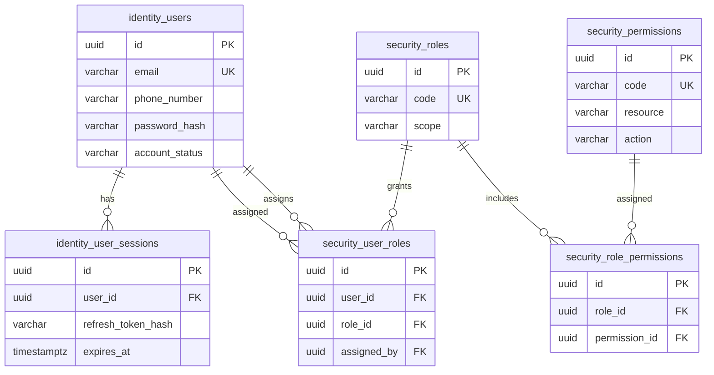
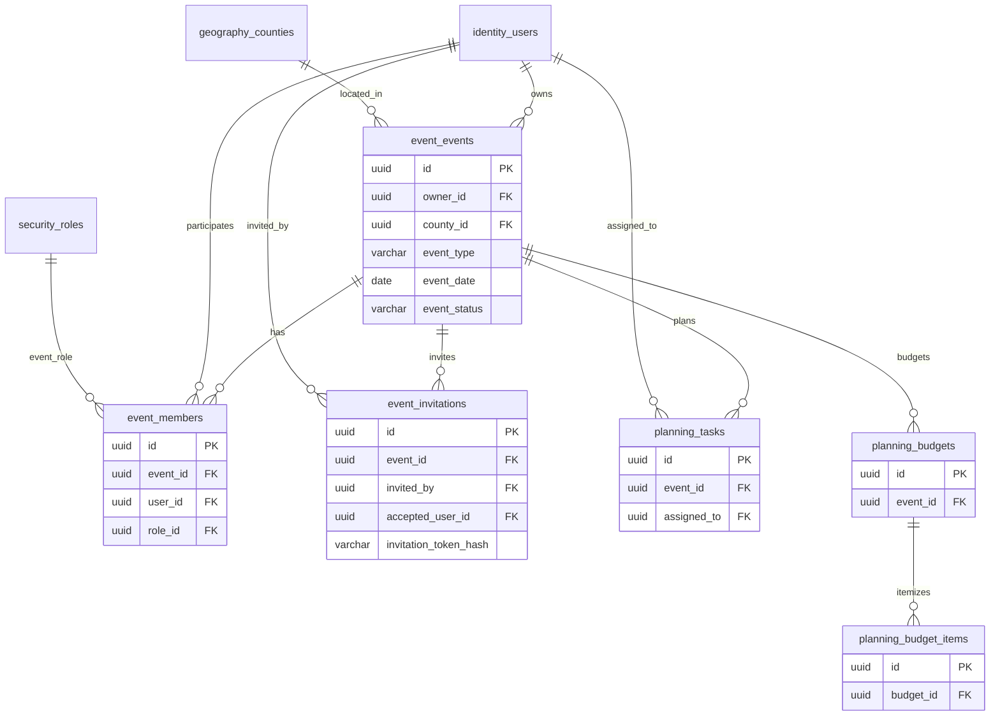
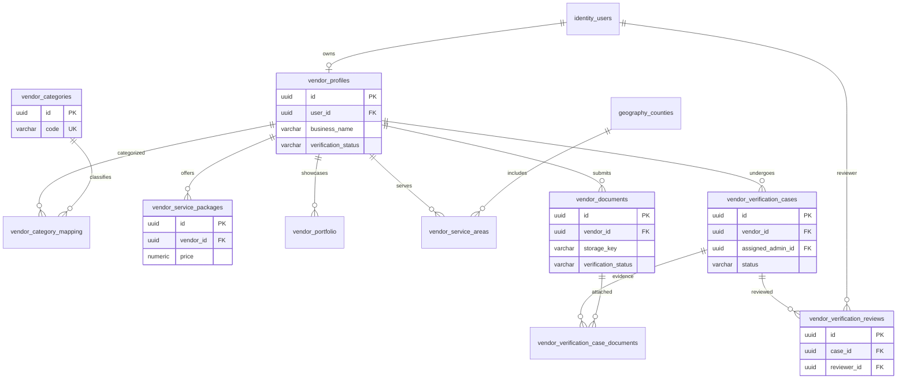
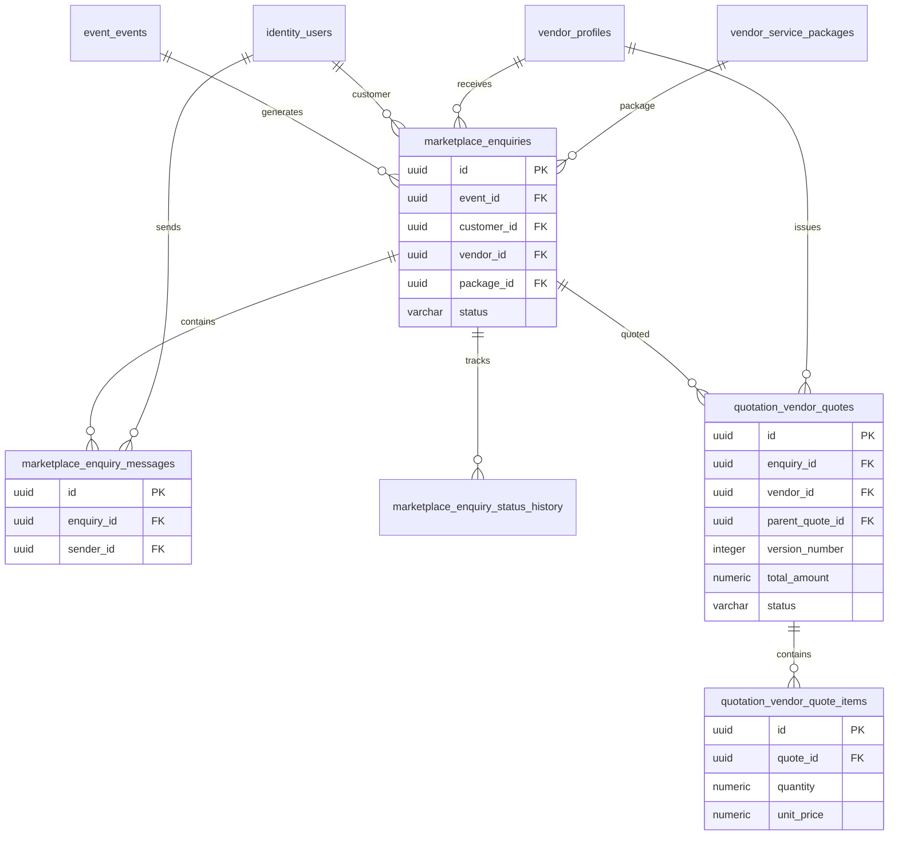
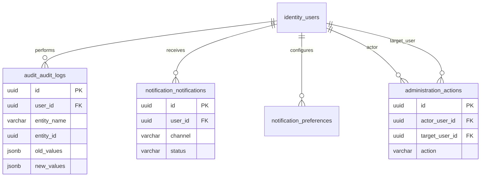

# Final Logical ERD — V2

The diagrams below represent the implemented table relationships in this migration package.
Mermaid diagrams render in GitHub, GitLab and compatible Markdown viewers.

## 1. Identity and RBAC

## 2. Events, collaboration and planning

## 3. Vendor, verification and geography

## 4. Marketplace and quotations

## 5. Audit, notifications and administration

**Relationship notes**
- All business entities use UUID primary keys.
- `event_members` is unique per `(event_id, user_id)`.
- A vendor profile is one-to-one with its owning user.
- A vendor enquiry is tied to one event, customer and vendor.
- Quotations are versioned per enquiry; each revision points to its parent quote.
- Some semantic rules (for example, the enquiry customer must own or be authorized for the event, and an enquiry's package must belong to the same vendor) are enforced in the service layer unless explicitly represented by a composite database constraint.
